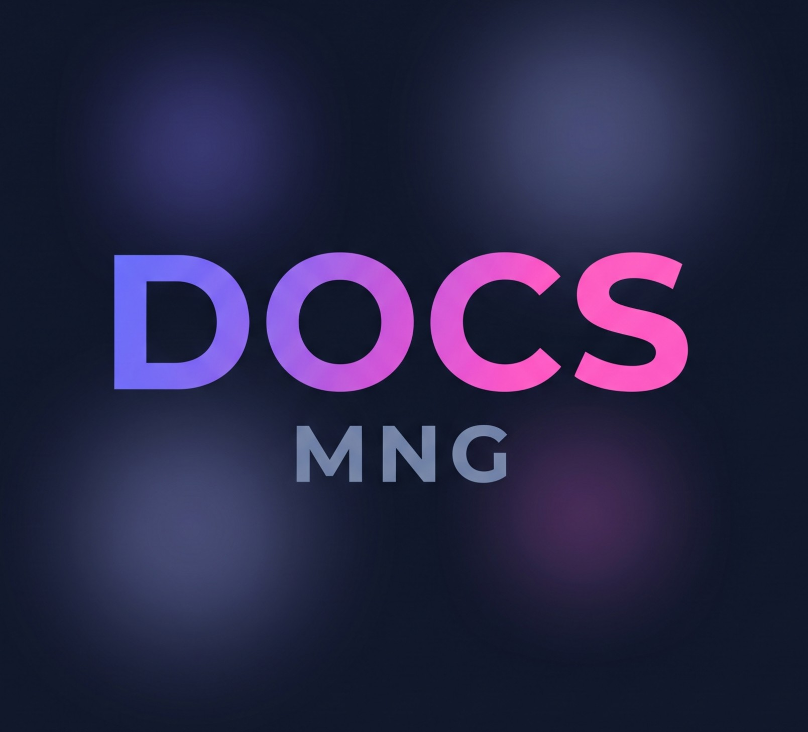

<div align="center">



**Tu centro de documentación técnica, rápido, ligero y con estilo.**

[](https://docs-mng.netlify.app)


[**Visitar la web →**](https://docs-mng.com)

</div>

---

## Sobre el proyecto

**DOCS-MNG** es una plataforma web ligera para centralizar, buscar y leer documentación técnica escrita en Markdown. Está pensada para ofrecer una lectura cómoda, sin instalaciones ni cuentas: abres la web, buscas la guía y la lees.

Las guías se mantienen como simples archivos `.md`, así que añadir contenido nuevo es tan fácil como escribir un documento y registrarlo en el catálogo.

---

## Características

| Funcionalidad | Descripción |
|---|---|
| **Lector Markdown** | Convierte los `.md` en HTML dinámicamente con [`marked.js`](https://marked.js.org/). |
| **Búsqueda por título** | Filtrado instantáneo del catálogo mientras escribes. |
| **Búsqueda por contenido** | Busca palabras clave dentro del texto completo de cada guía. |
| **Últimos visitados** | Historial guardado en `localStorage`, persistente entre sesiones y sin necesidad de cuenta. |
| **Recomendados** | Acceso rápido a las guías destacadas desde la barra lateral. |
| **Diseño moderno** | Estilo *glassmorphism* en modo oscuro, responsivo y con ancho acotado para pantallas grandes. |

---

## Contenido disponible

- **Instalación de sistemas operativos:** guías paso a paso de Windows 11 y Ubuntu Desktop.
- **Herramientas:** uso de instaladores de USB booteable (Rufus, Balena Etcher y Ventoy).
- **Utilidades:** arranque dual con Hyper-V y reinicio al inicio de la BIOS.
- **Legal:** aviso legal y política de privacidad.

---

## Tecnologías

**Frontend**
- **HTML5:** estructura semántica de las vistas (catálogo y lector).
- **CSS3:** variables nativas, efectos de difuminado, CSS Grid y Flexbox.
- **JavaScript:** manipulación del DOM, filtrado en memoria y gestión de eventos.
- **marked.js:** compilación de Markdown a HTML en el navegador.

**Despliegue**
- **Netlify:** contiene una función serverless (`netlify/functions/contact.mjs`).

---

## Estructura del proyecto

```text
doc-mng/
├── assets/
│   ├── css/
│   │   └── style.css
│   ├── docs/
│   │   ├── herramientas/
│   │   │   ├── instaladores-so/
│   │   │   ├── arranque-dual-hyper-v.md
│   │   │   └── reiniciar-inicio-bios.md
│   │   ├── legal/
│   │   │   ├── aviso-legal.md
│   │   │   └── politica-privacidad.md
│   │   ├── ubuntu/
│   │   │   └── instalacion/
│   │   │       └── instalacion-ubuntu.md
│   │   └── windows/
│   │       └── instalacion/
│   │           └── instalacion-windows-11.md
│   ├── img/
│   │   ├── herramientas/
│   │   │   └── instaladores-so/
│   │   │       ├── balena-etcher/
│   │   │       ├── rufus/
│   │   │       └── ventoy/
│   │   ├── kali-linux/
│   │   ├── ubuntu/
│   │   ├── windows/
│   │   └── logo-web.jpg
│   └── js/
│       └── app.js
├── netlify/
│   └── functions/
│       └── contact.mjs
├── index.html
├── LICENSE
├── netlify.toml
└── README.md
```

---

## Cómo añadir una guía

1. Crea el archivo `.md` en la carpeta que corresponda dentro de `assets/docs/`.
2. Guarda sus imágenes en `assets/img/`, siguiendo la misma jerarquía de carpetas.
3. Registra la guía en el catálogo de `assets/js/app.js`:

```js
{
  id: 10,
  title: "Título de la guía",
  summary: "Resumen breve que aparecerá en la tarjeta.",
  path: "assets/docs/carpeta/mi-guia.md",
  recommended: false
}
```

---

## Licencia

Este proyecto se distribuye bajo una **licencia propietaria**. Consulta el archivo [`LICENSE`](LICENSE) para más información.
